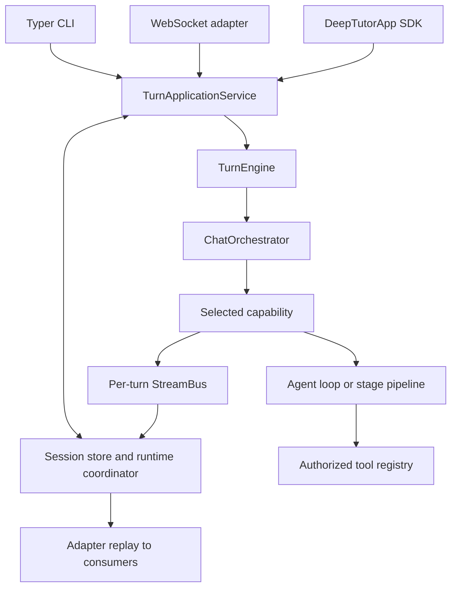

# 架构与源码归属

[手册](README.md) · [开发](DEVELOPMENT.md) · [事件](EVENTS_AND_PROGRESS.md)

DeepTutor 1.7.0 是一个源码仓库，包含独立打包的 Python 模块。CLI、WebSocket 和 Python SDK 入口在执行能力之前，统一汇聚到持久化应用服务。

## 追踪请求

| 职责 | 源码归属 |
| --- | --- |
| CLI 解析与命令 | [`deeptutor_cli/main.py`](../deeptutor_cli/main.py) |
| SDK 门面与应用请求 | [`deeptutor/app/`](../deeptutor/app/) |
| 持久化准入、执行与重放 | [`app/service.py`](../deeptutor/app/service.py) |
| WebSocket 适配 | [`unified_ws.py`](../deeptutor/api/routers/unified_ws.py) |
| 底层执行 | [`runtime/turn_engine.py`](../deeptutor/runtime/turn_engine.py) |
| 上下文到能力的路由 | [`runtime/orchestrator.py`](../deeptutor/runtime/orchestrator.py) |
| 能力/工具注册 | [`runtime/registry/`](../deeptutor/runtime/registry/) |
| 模块自有贡献 | [`modules/manifests/`](../deeptutor/modules/manifests/) |
| 共享聊天循环 | [`agents/loop/`](../deeptutor/agents/loop/) |
| 持久会话与轮次生命周期 | [`services/session/`](../deeptutor/services/session/) |
| Worker 租约与通知 | [`runtime/coordination/`](../deeptutor/runtime/coordination/) |

[`core/context.py`](../deeptutor/core/context.py) 中的 `UnifiedContext` 是执行上下文。入口应使用应用服务，而非实例化编排器来绕过持久化状态。持久化、提交标识、重放、取消和恢复属于共享的应用/运行时路径。修改流行为前请参阅[事件](EVENTS_AND_PROGRESS.md)。

## 工具、能力与模块

工具是模型选择的一个操作。能力拥有完整的一轮，可运行共享循环或多阶段流水线。`chat` 是默认能力；能力激活和上下文决定额外工具的可用性。每个能力都发出通用结果信封，包括用量成本。参见[扩展契约](TOOLS_AND_CAPABILITIES.md)。

官方[模块清单](MODULES.md#ownership-and-assembly)拥有包路径、依赖、能力、路由、CLI 组、导航和生命周期回调。已安装、已启用和就绪是独立状态。元数据必须在不导入不可用功能包的情况下可读。第三方[插件](PLUGINS.md)有自己的审查和生命周期规则；它们与官方模块 wheel 不同。

## 配置与隔离

[`runtime/home.py`](../deeptutor/runtime/home.py) 解析运行时主目录；[`services/config/runtime_settings.py`](../deeptutor/services/config/runtime_settings.py) 拥有设置和支持的进程覆盖。运行时设置位于 `data/user/settings/` 下；`.env` 不是应用配置来源。容器启动有自己的 JSON 到环境变量处理，详见[容器化](CONTAINERIZATION.md#runtime-configuration)。

账户授权与工作区选择是独立检查。路径和服务通过 [`services/workspace/`](../deeptutor/services/workspace/) 和 [`services/path_service.py`](../deeptutor/services/path_service.py) 解析。所选工作区数据、账户凭据和共享资源授权具有不同的生命周期；修改迁移或缓存前请参阅[存储](DATA_STORAGE.md)和[工作区契约](workspaces.md)。

## 前端边界

[`web/app/`](../web/app/) 中的 Next.js App Router 组合页面。领域、store 和传输切片位于 [`web/features/`](../web/features/) 下。可复用 UI 和传输原语位于 [`web/shared/`](../web/shared/) 下。[`web/contracts/`](../web/contracts/) 存放生成的 API 和轮次契约。

[依赖规则](../web/.dependency-cruiser.cjs)禁止循环、导入路由 `page.tsx` 模块、共享代码向上依赖，以及渲染层从功能领域/store/传输代码导入（指定的 settings-store 例外除外）。优先使用现有传输和 store 归属，而非组件本地的 WebSocket、重试或持久化实现。

[`web/proxy.ts`](../web/proxy.ts) 将 API/WebSocket 流量转发到后端。浏览器设置和运行时服务器配置是不同的边界；不要将部署地址或密钥硬编码到客户端代码中。

## 实验性引擎路径

Python 调度器仍是默认。`DEEPTUTOR_CHAT_ENGINE` 可选择由 [`packages/chat-engine/`](../packages/chat-engine/) 和 [`runtime/ts_engine/`](../deeptutor/runtime/ts_engine/) 实现的实验性 TypeScript 路径。原生路径有兼容性检查和 Python 集成点。旧迁移计划不能证明整个后端已迁移到 TypeScript。此处的更改必须保留应用服务、存储和公共事件契约；参见[测试](TESTING.md)中的专用引擎任务。