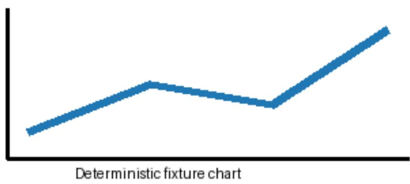

## DeepTutor LightRAG Bridge Fixture

一段简短段落，保留文本与标题层级。

$$
E = m c ^ { \wedge } 2
$$

表 1. 检索引擎路径
<table><tr><td>引擎</td><td>路径</td></tr><tr><td>LightRAG</td><td>原生</td></tr></table>

  
图 1. 合成趋势图。